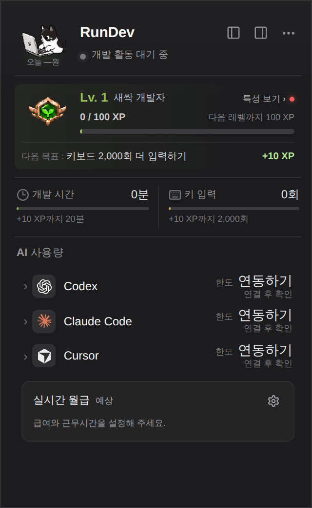
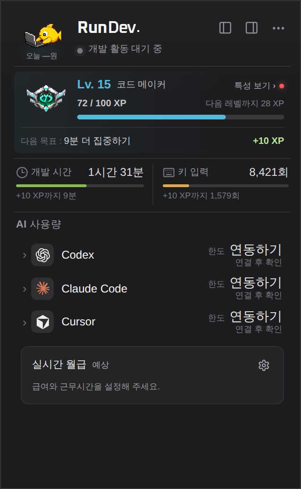
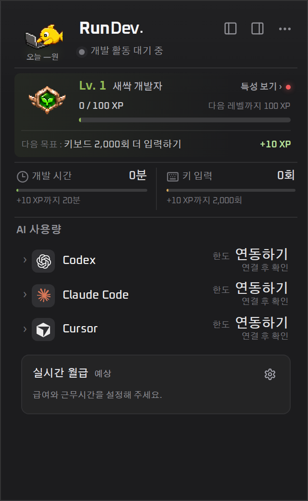
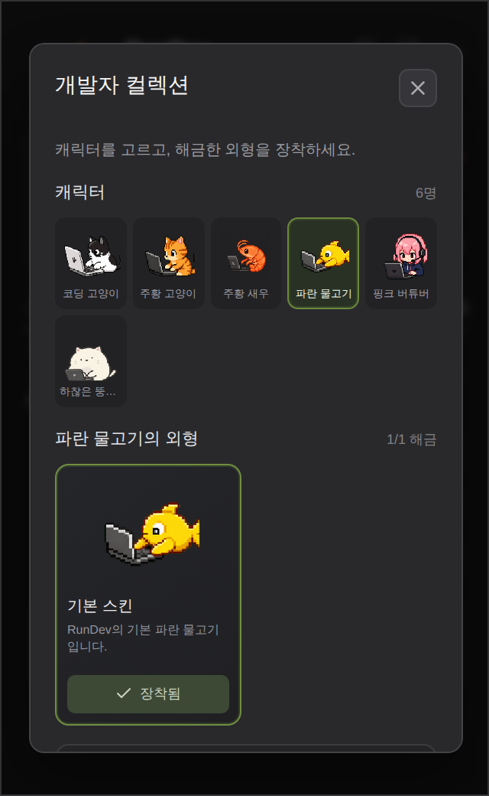
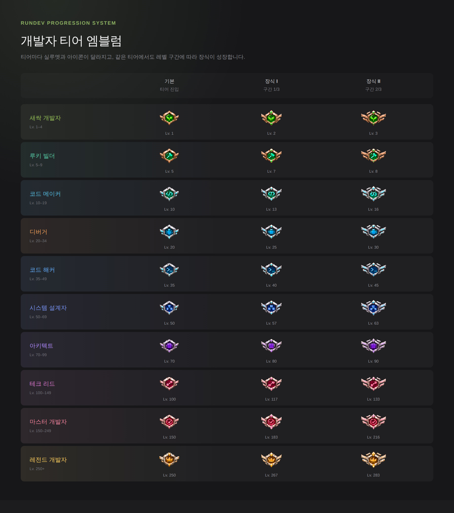
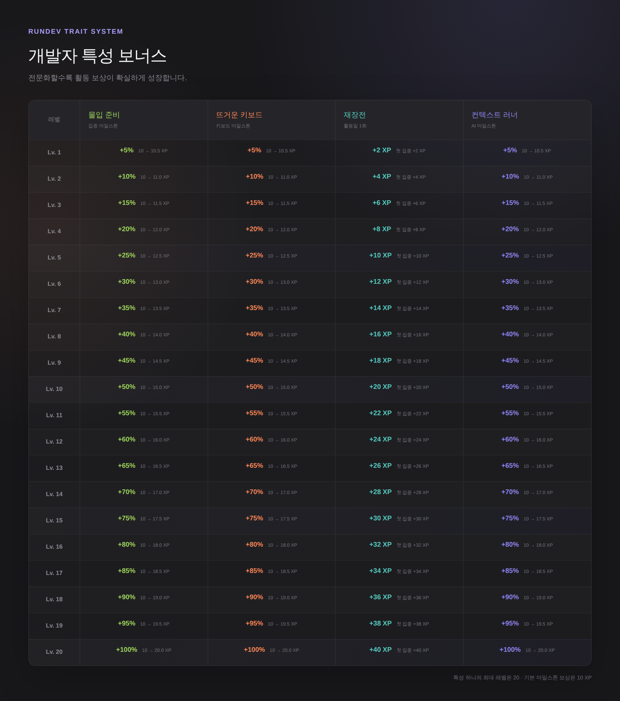

# RunDev

로컬 우선 개발 활동 컴패니언. Tauri 2, React, TypeScript, Rust, SQLite로 만든
Windows/macOS 트레이 앱입니다.

RunDev는 개발 활동과 사용자가 연결한 AI 도구의 집계 사용량을 로컬에서 기록하고,
XP와 작은 개발자 캐릭터로 보여줍니다. 키 입력 내용은 읽거나 저장하지 않고 누른
횟수만 집계하며, 프롬프트·응답·소스 코드 내용은 수집하지 않습니다.

## 주요 화면

| 연동 전 | AI 활동 중 |
| --- | --- |
|  |  |
| **연동 후 데이터 대기** | **개발자 변경** |
|  |  |

화면 이미지는 320×480 팝오버 크기의 고정된 미리보기 데이터로 생성됩니다. 실제
SQLite 데이터나 계정 정보는 문서 이미지 생성에 사용하지 않습니다.

## 실시간 월급

대시보드의 **급여 설정**에서 월 급여(원), 매월 급여일, 출퇴근·점심시간,
하루 총근무시간(분), 근무 요일을 입력합니다. 데스크톱 앱에서 근무 중 매초
예상 누적액과 오늘 금액을 표시하며, 점심·퇴근 후·비근무일에는 멈춥니다.
설정은 기기의 SQLite에만 저장하고 **설정 삭제**로 지울 수 있습니다.

팝오버와 플로팅 모드에서 근무 중 매초 흰색 `+₩3.42`가 캐릭터 중앙에서 나타나
위로 떠오르며 희미해져 사라집니다.
효과는 약 0.55초 안에 머리 근처에서 사라지고, 팝오버 캐릭터 아래에는 오늘 번
금액을 표시합니다.
플로팅 모드에서는 `오늘 12,345원째 버는 중!` 말풍선으로 오늘 누적액도 보여줍니다.
점심·퇴근 후에는 증가 효과를 멈추고 말풍선을 쉬는 중으로 표시합니다.

직전 급여일부터 다음 급여일까지의 근무시간에 월 급여를 균등 분배하고 급여일
0시에 새 주기를 시작합니다. 없는 급여일은 말일로 처리합니다. 세금·공휴일·휴가·
야간근무와 회사별 급여 규정은 반영하지 않는 예상액입니다. 브라우저 미리보기는
저장·계산을 지원하지 않습니다.

## 개발자 레벨



활동 XP 100마다 레벨이 오르며, 레벨 구간에 따라 배지 색상과 개발자 등급이
변합니다. 각 티어에 진입하면 기본 엠블럼을 받고, 해당 티어 레벨 구간의 1/3에서
외곽 판 한 겹, 2/3에서 두 번째 외곽 판과 하단 셰브론이 추가됩니다.

| 레벨 | 등급 |
| --- | --- |
| 1–4 | 새싹 개발자 |
| 5–9 | 루키 빌더 |
| 10–19 | 코드 메이커 |
| 20–34 | 디버거 |
| 35–49 | 코드 해커 |
| 50–69 | 시스템 설계자 |
| 70–99 | 아키텍트 |
| 100–149 | 테크 리드 |
| 150–249 | 마스터 개발자 |
| 250+ | 레전드 개발자 |

## 개발자 특성



레벨업으로 얻은 특성 포인트를 집중시간, 키보드, 꾸준한 활동 보상에
분배할 수 있습니다. 몰입 준비·뜨거운 키보드·컨텍스트 러너는 레벨당 해당
마일스톤 XP를 5% 높이며, 재장전은 활동일의 첫 집중 20분에 레벨당 2 XP를
추가합니다. 각 특성은 최대 20레벨입니다.

## 지원 개발자 캐릭터

| 코딩 고양이 | 주황 고양이 | 주황 새우 | 노란 물고기 | 핑크 버튜버 |
| --- | --- | --- | --- | --- |
|  |  |  |  |  |

개발자 캐릭터는 앱의 **개발자 변경** 메뉴에서 선택하며, 헤더와 네이티브 트레이 애니메이션에
동시에 적용됩니다.

## 개발

```powershell
npm.cmd install
npm.cmd run tauri dev
```

브라우저에서 UI만 확인하려면 `npm.cmd run dev`를 사용합니다. README용 주요 화면과
개발자 캐릭터 GIF를 로컬에서 다시 만들려면 다음 명령을 실행합니다.

```powershell
npx.cmd playwright install chromium
npm.cmd run build
npm.cmd run docs:assets
```

`main`에 UI 또는 개발자 캐릭터 애셋 변경이 푸시되면 GitHub Actions가 이미지를 다시 만들고,
변경된 결과만 자동 커밋합니다.

## 버전

앱 버전은 여러 패키지와 번들 설정에서 동일하게 유지합니다. 직접 개별 파일을
수정하지 않고 다음 명령을 사용합니다.

```powershell
npm.cmd run version:check
npm.cmd run version:set -- 0.2.0
```

릴리스 정책과 태그 절차는 [버전과 릴리스 관리](docs/releases/versioning.md)를 참고합니다.

## 현재 구현

- 트레이 상주 및 좌클릭으로 창 토글
- 창을 닫아도 백그라운드 유지
- 단일 인스턴스와 우클릭 종료 메뉴
- 32×32 PNG 프레임 트레이 애니메이션
- 256×256 마스터에서 생성하는 128×128 고해상도 화면 개발자 캐릭터
- 고양이 2종, 주황 새우, 노란 물고기, 핑크 버튜버 선택
- SQLite 자동 생성과 초기 마이그레이션
- Codex·Cursor 계정 사용량과 Claude Code OpenTelemetry 집계
- 연결한 Codex·Claude·Cursor의 계정 한도 사용률과 초기화 남은 시간 표시(1분 간격 갱신).
  한도 비율은 일별 토큰 집계와 별개이며, 토큰 집계가 지연되거나 수집되지 않아도
  계정 한도를 확인할 수 있다. Claude 구독 한도는 Claude Code 로그인 정보로 조회한다.
- 오늘 누른 키보드 횟수 집계와 2,000회당 10 XP 지급
- 개발 도구 활동 20분당 10 XP 지급과 최근 20주 활동 잔디
- 레벨 구간별 개발자 등급과 성장 배지
- 레벨업 포인트로 강화하는 네 가지 개발자 특성
- Rust command를 통한 요약·캐릭터·AI 상태 조회
- React + Zustand 대시보드
- GitHub Releases 기반 앱 업데이트 확인과 수동 설치

Updater는 서명된 `latest.json` endpoint로 새 버전을 확인합니다. Updater가 처음
포함된 빌드는 한 번 수동 설치해야 이후 버전을 자동으로 감지합니다.

## 문서

- [문서 인덱스](docs/README.md)
- [시스템 아키텍처](docs/architecture/overview.md)
- [ADR 인덱스](docs/decisions/README.md)
- [제품 로드맵](docs/product/roadmap.md)
- [변경 기록](CHANGELOG.md)
- [AI 및 기여자 작업 규칙](AGENTS.md)
