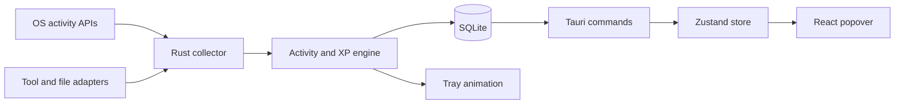
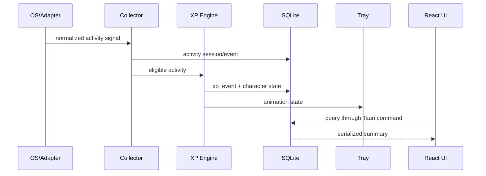

# 시스템 아키텍처

## 목표

RunDev는 개발 활동을 로컬에서 측정하고 XP와 캐릭터 상태로 변환하는 트레이 상주
앱이다. React 화면이 닫혀 있어도 수집, 계산, 저장, 트레이 애니메이션은 계속
동작해야 한다.

## 컨테이너 구조



## 프로세스 모델

RunDev는 하나의 Tauri 프로세스로 실행된다.

```text
RunDev process
├─ Tauri main thread
│  ├─ tray icon and native menu
│  └─ hidden/visible WebView lifecycle
├─ Tokio runtime
│  ├─ tray animation timer
│  ├─ foreground development activity collector
│  ├─ keyboard count collector
│  └─ AI adapter workers
├─ sqlx SQLite pool
└─ React WebView (visible only while popover is open)
```

## 현재 구현

AI 한도 사용률은 Rust `adapters/usage_limits`가 소유한다. 연결한 Codex의
`account/rateLimits/read`, Claude 계정 사용량 API, 기존 Cursor Dashboard 스냅샷을
정규화해 메모리에서 제공한다. 네이티브 작업자가 60초 간격으로 갱신하며 Tauri
`get_account_usage_limits`는 캐시를 즉시 반환하고 필요한 갱신을 별도로 시작한다.
429는 재시도 간격을 늘린다. React는 사용률과 초기화 남은 시간을 표시한다.
일별 토큰/OTel 집계와 별개이며 이 한도 비율은 XP 계산에 사용하지 않는다(ADR 0043).

- 단일 인스턴스
- 트레이 좌클릭 팝오버와 우클릭 메뉴
- 4프레임 coding 애니메이션
- 팝오버 헤더 개발자 캐릭터 채찍질(로컬 일별 횟수)
- SQLite 생성 및 migration
- 활성 개발 앱과 5분 idle 기준의 집중시간 세션 수집
- 키보드 입력 횟수 수집
- Codex 및 Claude Code 사용량 연동
- 오늘 요약과 캐릭터 상태 command
- Zustand 기반 React 대시보드

Windows 개발 앱 목록에는 `Orca.exe`를 포함한다. 실행 파일 이름을 정확히 대조하며
이름 일부가 비슷한 다른 앱은 포함하지 않는다.

시스템 상세 패널은 492px, 기본 팝오버는 320px다. 요약 고정 상태에서 상세를 접으면
52px 아이콘 영역을 남겨 372px를 유지한다. 같은 고정 상태를 화면과 Rust 창 크기
command에 전달하고 재실행 시에도 복원한다.

Windows 키보드는 정렬된 `RAWINPUT` 저장 공간을 사용하되 실제 키보드 패킷 크기
(x64 40바이트)를 허용한다. `RAWINPUT` 전체 union 크기(x64 48바이트)와 같아야 한다는
검사를 하지 않으며, 짧은 패킷의 미사용 영역을 0으로 초기화하고 타입을 확인한 뒤
키보드 구조체를 해석한다. 내용·순서는 저장하지 않고 기존 정책대로 횟수만 집계한다.

## 주요 모듈

급여 카운터는 `commands` → `salary::load/save/calculate` → `app_settings` 경계를
따른다. `salary::calculate`는 현재 로컬 시각을 인자로 받는 순수 도메인 함수다.
React `SalaryCard`는 `src/services/salary.ts`를 통해 매초 스냅샷을 받아 표시하고,
숨김 상태에서는 조회를 쉬며 다시 표시되면 즉시 갱신한다. 급여 원장이나 백그라운드
누적 작업은 없으며 재실행 시 같은 설정과 시각으로 복원한다. ADR 0042를 따른다.

`useSalarySnapshot`은 헤더와 플로팅 급여 창에 같은 Rust 계산 결과를 표시한다.
`character_salary`는 별도 투명·비활성·마우스 통과 창의 위치와 표시 상태만 소유한다.
캐릭터 창의 이동·크기 변경 이벤트에 따라 위치를 갱신하고, 화면 가장자리에서는
작업 영역 안으로 보정한다. 보정 후 캐릭터 중앙 좌표를 논리 좌표로 변환해
`character-salary-anchor` 이벤트로 전달한다. React는 그 위치에서 매초 증가액을
위로 떠오르며 사라지게 표시한다. 화면 상단에서는 말풍선만 캐릭터 아래에 둔다.
같은 이벤트의 `characterSize`는 DPI를 제외한 캐릭터 논리 크기다. 말풍선의 글자·여백·
꼬리는 기본 48px 대비 비율로 확대·축소하며, Rust도 투명 창의 여유 영역을 함께
조절한다. 말풍선 꼬리는 화면 가장자리 보정 후에도 캐릭터 중심을 향하도록 옮긴다.
`character-salary`의 `parent`를 `character`로 설정해 클릭·드래그 후에도 효과가
캐릭터 앞에 유지되도록 한다. Windows에서는 owner 관계, macOS에서는 위에 배치한
child window 관계를 사용한다. 금액 효과는 같은 창 안의 말풍선보다도 앞에 그린다.
급여 설정 저장·삭제 시 `salary-settings-changed` 이벤트로 모든 화면을 갱신한다.

```text
src-tauri/src/
├─ activity/
│  ├─ catalog.rs
│  ├─ windows.rs
│  └─ macos.rs
├─ adapters/
│  ├─ codex.rs
│  ├─ claude.rs
│  ├─ cursor.rs
│  └─ ollama.rs
├─ xp/
│  ├─ engine.rs
│  └─ rules.rs
├─ database/
├─ tray/
└─ commands/
```

`activity`는 OS 상태를 공통 집중 세션으로 정규화한다. `xp`와 아직 구현하지 않은
어댑터 폴더는 실제 기능을 추가할 때만 만든다.

## 핵심 데이터 흐름



React가 DB에 직접 연결되는 화살표는 허용하지 않는다.

AI 토큰 기반 XP 서비스와 주간 XP UI는 ADR 0044로 종료했다. 기존 XP 이력은 보존하며,
요약 화면의 해당 공간에는 실시간 예상 급여를 표시한다. 급여는 XP와 연계하지 않는다.
급여 스냅샷의 `workStatus`와 `secondsUntilEnd`도 Rust가 설정 요일·시간에서 계산한다.
React는 근무/점심/퇴근 상태와 퇴근 시각까지의 시·분·초만 표시하며, 출근 전과 휴무를
별도로 구분한다. 남은 시간은 점심시간을 포함한 실제 시계 기준이다.

대시보드의 정상 흐름 내용 높이는 React ResizeObserver가 측정하고,
`set_main_window_content_height`를 통해 Rust가 DPI·작업 영역에 맞춰 창 높이를 조절한다.
AI 상세는 창 안에 고정 배치하는 오버레이이므로 행이나 창 높이를 밀지 않는다.
긴 설정 모달은 스크롤을 허용하며 스크롤바는 숨긴다(ADR 0045).
